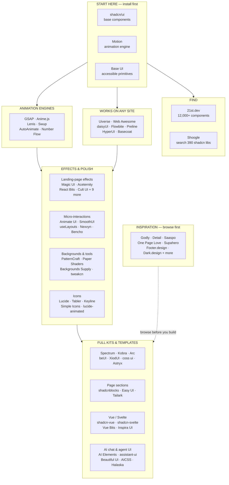

# Aaron's UI/UX Library Collection

> My every-project starter kit for UI — copy-paste components, animation engines, icons, backgrounds, and inspiration.
> Start with the 3 in “Start here”, then pick by what you are building. Same idea as my Skill Stack: one curated list, categorised so you can find the right piece in seconds.

Costs and “(new)” tags are as in the source table, Oct 2026 — prices and sale prices move fast, so check the site before buying. “(new)” means added in this revision of the list.

---

## Contents

- [Quick reference](#quick-reference)
- [By cost — Free vs Paid](#by-cost--free-vs-paid)
- [How to pick](#how-to-pick)
- [Architecture — where each category sits](#architecture--where-each-category-sits)
- [The collection — 79 libraries](#the-collection--79-libraries)
- [Newer libraries to watch](#newer-libraries-to-watch)
- [Keeping this list fresh](#keeping-this-list-fresh)
- [Adding a library](#adding-a-library)

---

## Quick reference

| # | Library | Category | Works in | Cost | Best for |
|---|---------|----------|----------|------|----------|
| 1 | [shadcn/ui](https://ui.shadcn.com) | Start here | React + Tailwind | Free | The base components most of this list is built on |
| 2 | [Motion](https://motion.dev) | Start here | React, plain JS, Vue | Free; Motion+ is a one-time purchase (€299 at launch) | Writing your own animations; most libraries here use it |
| 3 | [Base UI (new)](https://base-ui.com) | Start here | React, with any styling (the components come unstyled) | Free | Accessible building blocks from the Material UI team; shadcn/ui can run on it |
| 4 | [21st.dev](https://21st.dev) | Find components | React + Tailwind | Free to browse, with a daily copy limit; paid from $6/mo, billed yearly | 12,000+ community components that install straight into AI coding tools |
| 5 | [Shoogle](https://shoogle.dev) | Find components | React + Tailwind | Free | Searching about 390 shadcn component libraries at once |
| 6 | [Uiverse](https://uiverse.io) | Works on any site (including WordPress) | Any site (HTML/CSS) | Free | 7,000+ buttons, loaders, toggles, cards and inputs |
| 7 | [CSS Button Library](https://animatedbuttons.colorion.co) | Works on any site (including WordPress) | Any site (CSS) | Free | 99 button hover effects |
| 8 | [Transitions.dev](https://transitions.dev) | Works on any site (including WordPress) | Any site (CSS); Pro adds React | Free core; Pro $9/mo or $149 one-time | Animations for modals, toasts and tooltips; an AI agent can add them for you |
| 9 | [Web Awesome (new)](https://webawesome.com) | Works on any site (including WordPress) | Any site, with no framework or Tailwind needed (it uses web components) | Free core; Pro is paid | 50+ ready-made components you drop into plain HTML |
| 10 | [daisyUI (new)](https://daisyui.com) | Works on any site (including WordPress) | Any site that loads Tailwind CSS | Free | Ready-made component classes (buttons, cards, modals) for plain HTML |
| 11 | [Flowbite (new)](https://flowbite.com) | Works on any site (including WordPress) | Any site that loads Tailwind CSS; also React, Vue, Svelte | Free core; Pro is paid | Interactive components (dropdowns, modals, carousels) that come with their own JavaScript |
| 12 | [Preline UI (new)](https://preline.co) | Works on any site (including WordPress) | Any site that loads Tailwind CSS | Free core; Pro $249 one-time | A large set of components, blocks and templates |
| 13 | [HyperUI (new)](https://hyperui.dev) | Works on any site (including WordPress) | Any site that loads Tailwind CSS | Free | Copy-paste sections for marketing sites and dashboards |
| 14 | [Basecoat (new)](https://basecoatui.com) | Works on any site (including WordPress) | Any site that loads Tailwind CSS | Free | The shadcn/ui look without React |
| 15 | [GSAP (new)](https://gsap.com) | Animation libraries (plain JavaScript, any site) | Any site; also React and Vue | Free, including all its plugins | Scroll-triggered and timeline animations |
| 16 | [Anime.js (new)](https://animejs.com) | Animation libraries (plain JavaScript, any site) | Any site | Free | Lightweight animations of CSS, SVG and page elements |
| 17 | [Lenis (new)](https://lenis.darkroom.engineering) | Animation libraries (plain JavaScript, any site) | Any site; also React and Vue | Free | Smooth scrolling; pairs well with GSAP |
| 18 | [Swup (new)](https://swup.js.org) | Animation libraries (plain JavaScript, any site) | Regular multi-page sites | Free | Animated page transitions without building a single-page app |
| 19 | [AutoAnimate (new)](https://auto-animate.formkit.com) | Animation libraries (plain JavaScript, any site) | Any site; also React, Vue, Svelte | Free | One-line animations when items are added, removed or moved |
| 20 | [Number Flow (new)](https://number-flow.barvian.me) | Animation libraries (plain JavaScript, any site) | Any site; also React, Vue, Svelte | Free | Animated, odometer-style numbers |
| 21 | [Magic UI](https://magicui.design) | Landing-page effects | React + Tailwind | Free; Pro $199 one-time | Text effects, marquees, animated backgrounds |
| 22 | [Aceternity UI](https://ui.aceternity.com) | Landing-page effects | React + Tailwind | Free; Pro $169/yr or $199 one-time (sale prices) | Flashy hero sections and effects |
| 23 | [React Bits](https://reactbits.dev) | Landing-page effects | React (Tailwind or plain CSS) | Free; Pro from $129 one-time | Animated text and backgrounds for creative sites |
| 24 | [Cult UI](https://www.cult-ui.com) | Landing-page effects | React + Tailwind | Free; Pro $129 one-time (sale price) | Unusual components; Pro adds full Next.js starter apps |
| 25 | [Rare UI](https://www.rareui.com) | Landing-page effects | React + Tailwind | Free | Unusual effects like animated orbs and grid reveals |
| 26 | [Spell UI](https://spell.sh) | Landing-page effects | React + Tailwind | Free | Small animated text, buttons and backgrounds |
| 27 | [ObsidianUI](https://obsidianui.dev) | Landing-page effects | React + Tailwind | Free | Showpiece galleries, marquees and text effects (small, new library) |
| 28 | [UImaxxing](https://uimaxx.ing) | Landing-page effects | React + Tailwind | Free; Pro $50 one-time | Flashy AI, fintech and crypto-style pieces |
| 29 | [Motion Primitives (new)](https://motion-primitives.com) | Landing-page effects | React + Tailwind | Free; Pro is paid (yearly or lifetime) | Animated text, carousels, dialogs and transitions |
| 30 | [Skiper UI (new)](https://skiper-ui.com) | Landing-page effects | React + Tailwind | Some free; Premium $129 one-time | Uncommon, eye-catching components |
| 31 | [Originkit (new)](https://www.originkit.dev) | Landing-page effects | React or Framer | Free for 10 copies a day; Pro $79/yr or Ultimate $99/yr (sale prices) | 60+ animated components you adjust in the browser before copying |
| 32 | [Canvas UI (new)](https://canvasui.dev) | Landing-page effects | React, Vue, Svelte or plain JS | Free | WebGL effects layered over real HTML. Some effects need an experimental Chrome feature for now |
| 33 | [ThreeUI (new)](https://threeui.com) | Landing-page effects | React + three.js | Free community edition; Pro $199/yr or $299 one-time | 3D scenes, WebGL backgrounds and hero sections |
| 34 | [Animate UI](https://animate-ui.com) | Micro-interactions | React + Tailwind | Free | Animated dialogs, tabs, accordions and tooltips |
| 35 | [useLayouts](https://uselayouts.com) | Micro-interactions | React + Tailwind | Free | Animated tabs, menus and hover effects |
| 36 | [Nexvyn UI](https://ui.nexvyn.dev) | Micro-interactions | React + Tailwind | Free | Sliders, color picker, gooey dropdowns |
| 37 | [Bencho](https://bencho.dev) | Micro-interactions | Probably React (the site doesn't say) | No pricing shown | Widgets you adjust live before copying (signature pad, code input, radial menu) |
| 38 | [SmoothUI (new)](https://smoothui.dev) | Micro-interactions | React + Tailwind | Free | About 200 polished animated components, plus blocks and templates |
| 39 | [Spectrum UI](https://ui.spectrumhq.in) | Full component kits | React + Tailwind | Free | A big free set for SaaS and AI apps; has an MCP server for AI tools |
| 40 | [Kobra](https://kobra.systems) | Full component kits | React + Tailwind (plus a Figma kit) | 10 free (personal use only); $199 one-time | A polished, accessible kit for commercial products |
| 41 | [Arc](https://uiarc.dev) | Full component kits | React | Free core; Pro $129/yr or $199 one-time ($99 launch deal right now) | Heavily animated components plus page sections |
| 42 | [beUI](https://beui.dev) | Full component kits | React + Tailwind | Free; Pro $129/yr or $179 one-time | Heavily animated UI, AI chat pieces and charts |
| 43 | [XiodUI](https://ui.xiod.dev) | Full component kits | React + Tailwind (npm package) | Free | Special inputs such as phone numbers, payment cards and pickers |
| 44 | [coss ui (new)](https://coss.com/ui) | Full component kits | React + Tailwind | Free | Cal.com's design system (formerly Origin UI), built on Base UI |
| 45 | [Astryx (new)](https://astryx.atmeta.com) | Full component kits | React, no Tailwind (it uses StyleX) | Free (still in beta) | Meta's 170+ component design system, now open source |
| 46 | [shadcn-vue (new)](https://shadcn-vue.com) | Vue and Svelte | Vue + Tailwind | Free | shadcn/ui in Vue projects |
| 47 | [shadcn-svelte (new)](https://shadcn-svelte.com) | Vue and Svelte | Svelte + Tailwind | Free | shadcn/ui in Svelte projects |
| 48 | [Vue Bits (new)](https://vue-bits.dev) | Vue and Svelte | Vue or Nuxt | Free | The Vue version of React Bits |
| 49 | [Inspira UI (new)](https://inspira-ui.com) | Vue and Svelte | Vue or Nuxt + Tailwind | Free; Pro $249 one-time with their current 50%-off code (normally $499) | Animated Vue components in the style of Aceternity UI |
| 50 | [Beautiful UI](https://beautifului.dev) | AI chat and agent UI | React + Tailwind | Free | “Thinking” states, streaming text, approval cards |
| 51 | [AICSS](https://www.aicss.dev) | AI chat and agent UI | React, Vue or Svelte (no Tailwind) | 12 free; Pro $89 one-time | The same kind of AI chat pieces, and not just for React |
| 52 | [Halaska UI](https://ui.halaska.com) | AI chat and agent UI | React (no Tailwind) | Free | AI app screens (chat, canvas) that a coding agent sets up for you |
| 53 | [libraries.dev](https://libraries.dev) | AI chat and agent UI | React | Free core; Pro $9/mo or $149 one-time | AI-style effects such as glowing borders, orbs and liquid metal |
| 54 | [assistant-ui (new)](https://www.assistant-ui.com) | AI chat and agent UI | React | Free | A full ChatGPT-style chat interface in your own app |
| 55 | [AI Elements (new)](https://ai-sdk.dev/elements) | AI chat and agent UI | React + Tailwind (shadcn/ui) | Free | Vercel's chat building blocks (messages, reasoning, tool calls) for AI SDK apps |
| 56 | [shadcnblocks](https://www.shadcnblocks.com) | Page sections and templates | React + Tailwind | Some free (login needed); paid from $149 one-time | About 2,000 ready-made page sections |
| 57 | [Easy UI](https://www.easyui.pro) | Page sections and templates | Next.js + Tailwind | Free templates; Premium $49 one-time (going up to $79) | Starter sites such as a landing page, portfolio or waitlist |
| 58 | [Tailark (new)](https://tailark.com) | Page sections and templates | React + Tailwind (shadcn/ui) | Free blocks; paid kits from $249 one-time | Marketing-site blocks, pages and illustrations in several styles |
| 59 | [Keyline Icons](https://keylineicons.com) | Icons | Any site (SVG), React, Figma | Free | 1,233 icons in 8 variants each, drawn to match shadcn's icons |
| 60 | [Lucide (new)](https://lucide.dev) | Icons | Any site (SVG or plain JS); also React, Vue, Svelte | Free | The clean line icons shadcn/ui uses by default |
| 61 | [Tabler Icons (new)](https://tabler.io/icons) | Icons | Any site (SVG or icon font); also React, Vue, Svelte | Free | 6,000+ consistent line icons |
| 62 | [Simple Icons (new)](https://simpleicons.org) | Icons | Any site (SVG) | Free | Brand and company logos |
| 63 | [lucide-animated (new)](https://lucide-animated.com) | Icons | React + Motion | Free | 350+ animated versions of Lucide icons |
| 64 | [Backgrounds Supply](https://backgrounds.supply) | Backgrounds, shaders and tools | Any site or slides (PNG/MP4) | 100+ free (personal use only); $49 one-time | Hero and section backgrounds, gradients |
| 65 | [PatternCraft (new)](https://patterncraft.fun) | Backgrounds, shaders and tools | Any site (CSS or Tailwind) | Free | 100+ copy-paste background patterns and gradients |
| 66 | [Paper Shaders (new)](https://shaders.paper.design) | Backgrounds, shaders and tools | React or plain JS | Free | Mesh gradients, grain, dithering and other shader backgrounds |
| 67 | [Unicorn Studio (new)](https://www.unicorn.studio) | Backgrounds, shaders and tools | Any site (embed code) | Free plan; Legend $20/mo or $168/yr | Designing WebGL effects without code, then embedding them |
| 68 | [animos](https://animos.app) | Backgrounds, shaders and tools | The browser, no code | Free for now (according to a July review) | Turning design screenshots into showcase videos |
| 69 | [tweakcn (new)](https://tweakcn.com) | Backgrounds, shaders and tools | shadcn/ui projects | Free; Pro $8/mo | Designing a custom shadcn/ui theme visually, then copying the code |
| 70 | [Godly](https://godly.design) | Inspiration | — | Free | Standout website and landing-page designs |
| 71 | [Detail](https://detail.design) | Inspiration | — | Free | Small details that make a UI feel polished |
| 72 | [Built by Designers](https://builtbydesigners.com) | Inspiration | — | Free | Real products that designers built themselves |
| 73 | [before.click](https://before.click) | Inspiration | — | Free | iOS App Store screenshots, paywalls, onboarding screens |
| 74 | [deck.gallery](https://deck.gallery) | Inspiration | — | Free sample; Pro $144/yr | Ideas for slide decks, reports and brand guidelines |
| 75 | [Saaspo (new)](https://saaspo.com) | Inspiration | — | Free | 3,000+ SaaS website pages, sorted by page type and industry |
| 76 | [Supahero (new)](https://supahero.io) | Inspiration | — | Free | Website hero sections |
| 77 | [One Page Love (new)](https://onepagelove.com) | Inspiration | — | Free to browse; some templates are paid | 9,000+ one-page sites and section examples |
| 78 | [Footer.design (new)](https://www.footer.design) | Inspiration | — | Free | Website footers |
| 79 | [Dark.design (new)](https://www.dark.design) | Inspiration | — | Free | Dark-themed websites |

---

## By cost — Free vs Paid

Same 79 libraries, re-sorted by cost. Categories above stay the primary organisation — this is the cross-cutting view when budget is the filter.

- **49 fully free** — no paid tier listed
- **29 freemium** — free tier / free core + paid Pro / Premium / paid kits
- **1 unknown** — no pricing shown (Bencho)
- **0 paid-only** — every paid option in this list has a free tier, free core, or free sample. “Paid” here means “has a paid upgrade”, not “costs money to start”.

Note: free ≠ unlimited. Check limits before relying on a free tier: 21st.dev has a daily copy limit, Originkit allows 10 free copies/day, Kobra gives 10 free for personal use only, Backgrounds Supply’s 100+ free are personal-use only.

### Fully free — 49

| # | Library | Category | Best for |
|---|---------|----------|----------|
| 1 | [shadcn/ui](https://ui.shadcn.com) | Start here | The base components most of this list is built on |
| 3 | [Base UI (new)](https://base-ui.com) | Start here | Accessible building blocks from the Material UI team; shadcn/ui can run on it |
| 5 | [Shoogle](https://shoogle.dev) | Find components | Searching about 390 shadcn component libraries at once |
| 6 | [Uiverse](https://uiverse.io) | Works on any site (including WordPress) | 7,000+ buttons, loaders, toggles, cards and inputs |
| 7 | [CSS Button Library](https://animatedbuttons.colorion.co) | Works on any site (including WordPress) | 99 button hover effects |
| 10 | [daisyUI (new)](https://daisyui.com) | Works on any site (including WordPress) | Ready-made component classes (buttons, cards, modals) for plain HTML |
| 13 | [HyperUI (new)](https://hyperui.dev) | Works on any site (including WordPress) | Copy-paste sections for marketing sites and dashboards |
| 14 | [Basecoat (new)](https://basecoatui.com) | Works on any site (including WordPress) | The shadcn/ui look without React |
| 15 | [GSAP (new)](https://gsap.com) | Animation libraries (plain JavaScript, any site) | Scroll-triggered and timeline animations |
| 16 | [Anime.js (new)](https://animejs.com) | Animation libraries (plain JavaScript, any site) | Lightweight animations of CSS, SVG and page elements |
| 17 | [Lenis (new)](https://lenis.darkroom.engineering) | Animation libraries (plain JavaScript, any site) | Smooth scrolling; pairs well with GSAP |
| 18 | [Swup (new)](https://swup.js.org) | Animation libraries (plain JavaScript, any site) | Animated page transitions without building a single-page app |
| 19 | [AutoAnimate (new)](https://auto-animate.formkit.com) | Animation libraries (plain JavaScript, any site) | One-line animations when items are added, removed or moved |
| 20 | [Number Flow (new)](https://number-flow.barvian.me) | Animation libraries (plain JavaScript, any site) | Animated, odometer-style numbers |
| 25 | [Rare UI](https://www.rareui.com) | Landing-page effects | Unusual effects like animated orbs and grid reveals |
| 26 | [Spell UI](https://spell.sh) | Landing-page effects | Small animated text, buttons and backgrounds |
| 27 | [ObsidianUI](https://obsidianui.dev) | Landing-page effects | Showpiece galleries, marquees and text effects (small, new library) |
| 32 | [Canvas UI (new)](https://canvasui.dev) | Landing-page effects | WebGL effects layered over real HTML. Some effects need an experimental Chrome feature for now |
| 34 | [Animate UI](https://animate-ui.com) | Micro-interactions | Animated dialogs, tabs, accordions and tooltips |
| 35 | [useLayouts](https://uselayouts.com) | Micro-interactions | Animated tabs, menus and hover effects |
| 36 | [Nexvyn UI](https://ui.nexvyn.dev) | Micro-interactions | Sliders, color picker, gooey dropdowns |
| 38 | [SmoothUI (new)](https://smoothui.dev) | Micro-interactions | About 200 polished animated components, plus blocks and templates |
| 39 | [Spectrum UI](https://ui.spectrumhq.in) | Full component kits | A big free set for SaaS and AI apps; has an MCP server for AI tools |
| 43 | [XiodUI](https://ui.xiod.dev) | Full component kits | Special inputs such as phone numbers, payment cards and pickers |
| 44 | [coss ui (new)](https://coss.com/ui) | Full component kits | Cal.com's design system (formerly Origin UI), built on Base UI |
| 45 | [Astryx (new)](https://astryx.atmeta.com) | Full component kits | Meta's 170+ component design system, now open source |
| 46 | [shadcn-vue (new)](https://shadcn-vue.com) | Vue and Svelte | shadcn/ui in Vue projects |
| 47 | [shadcn-svelte (new)](https://shadcn-svelte.com) | Vue and Svelte | shadcn/ui in Svelte projects |
| 48 | [Vue Bits (new)](https://vue-bits.dev) | Vue and Svelte | The Vue version of React Bits |
| 50 | [Beautiful UI](https://beautifului.dev) | AI chat and agent UI | “Thinking” states, streaming text, approval cards |
| 52 | [Halaska UI](https://ui.halaska.com) | AI chat and agent UI | AI app screens (chat, canvas) that a coding agent sets up for you |
| 54 | [assistant-ui (new)](https://www.assistant-ui.com) | AI chat and agent UI | A full ChatGPT-style chat interface in your own app |
| 55 | [AI Elements (new)](https://ai-sdk.dev/elements) | AI chat and agent UI | Vercel's chat building blocks (messages, reasoning, tool calls) for AI SDK apps |
| 59 | [Keyline Icons](https://keylineicons.com) | Icons | 1,233 icons in 8 variants each, drawn to match shadcn's icons |
| 60 | [Lucide (new)](https://lucide.dev) | Icons | The clean line icons shadcn/ui uses by default |
| 61 | [Tabler Icons (new)](https://tabler.io/icons) | Icons | 6,000+ consistent line icons |
| 62 | [Simple Icons (new)](https://simpleicons.org) | Icons | Brand and company logos |
| 63 | [lucide-animated (new)](https://lucide-animated.com) | Icons | 350+ animated versions of Lucide icons |
| 65 | [PatternCraft (new)](https://patterncraft.fun) | Backgrounds, shaders and tools | 100+ copy-paste background patterns and gradients |
| 66 | [Paper Shaders (new)](https://shaders.paper.design) | Backgrounds, shaders and tools | Mesh gradients, grain, dithering and other shader backgrounds |
| 68 | [animos](https://animos.app) | Backgrounds, shaders and tools | Turning design screenshots into showcase videos |
| 70 | [Godly](https://godly.design) | Inspiration | Standout website and landing-page designs |
| 71 | [Detail](https://detail.design) | Inspiration | Small details that make a UI feel polished |
| 72 | [Built by Designers](https://builtbydesigners.com) | Inspiration | Real products that designers built themselves |
| 73 | [before.click](https://before.click) | Inspiration | iOS App Store screenshots, paywalls, onboarding screens |
| 75 | [Saaspo (new)](https://saaspo.com) | Inspiration | 3,000+ SaaS website pages, sorted by page type and industry |
| 76 | [Supahero (new)](https://supahero.io) | Inspiration | Website hero sections |
| 78 | [Footer.design (new)](https://www.footer.design) | Inspiration | Website footers |
| 79 | [Dark.design (new)](https://www.dark.design) | Inspiration | Dark-themed websites |

### Freemium — free + paid upgrade — 29

| # | Library | Category | Cost | Best for |
|---|---------|----------|------|----------|
| 2 | [Motion](https://motion.dev) | Start here | Free; Motion+ is a one-time purchase (€299 at launch) | Writing your own animations; most libraries here use it |
| 4 | [21st.dev](https://21st.dev) | Find components | Free to browse, with a daily copy limit; paid from $6/mo, billed yearly | 12,000+ community components that install straight into AI coding tools |
| 8 | [Transitions.dev](https://transitions.dev) | Works on any site (including WordPress) | Free core; Pro $9/mo or $149 one-time | Animations for modals, toasts and tooltips; an AI agent can add them for you |
| 9 | [Web Awesome (new)](https://webawesome.com) | Works on any site (including WordPress) | Free core; Pro is paid | 50+ ready-made components you drop into plain HTML |
| 11 | [Flowbite (new)](https://flowbite.com) | Works on any site (including WordPress) | Free core; Pro is paid | Interactive components (dropdowns, modals, carousels) that come with their own JavaScript |
| 12 | [Preline UI (new)](https://preline.co) | Works on any site (including WordPress) | Free core; Pro $249 one-time | A large set of components, blocks and templates |
| 21 | [Magic UI](https://magicui.design) | Landing-page effects | Free; Pro $199 one-time | Text effects, marquees, animated backgrounds |
| 22 | [Aceternity UI](https://ui.aceternity.com) | Landing-page effects | Free; Pro $169/yr or $199 one-time (sale prices) | Flashy hero sections and effects |
| 23 | [React Bits](https://reactbits.dev) | Landing-page effects | Free; Pro from $129 one-time | Animated text and backgrounds for creative sites |
| 24 | [Cult UI](https://www.cult-ui.com) | Landing-page effects | Free; Pro $129 one-time (sale price) | Unusual components; Pro adds full Next.js starter apps |
| 28 | [UImaxxing](https://uimaxx.ing) | Landing-page effects | Free; Pro $50 one-time | Flashy AI, fintech and crypto-style pieces |
| 29 | [Motion Primitives (new)](https://motion-primitives.com) | Landing-page effects | Free; Pro is paid (yearly or lifetime) | Animated text, carousels, dialogs and transitions |
| 30 | [Skiper UI (new)](https://skiper-ui.com) | Landing-page effects | Some free; Premium $129 one-time | Uncommon, eye-catching components |
| 31 | [Originkit (new)](https://www.originkit.dev) | Landing-page effects | Free for 10 copies a day; Pro $79/yr or Ultimate $99/yr (sale prices) | 60+ animated components you adjust in the browser before copying |
| 33 | [ThreeUI (new)](https://threeui.com) | Landing-page effects | Free community edition; Pro $199/yr or $299 one-time | 3D scenes, WebGL backgrounds and hero sections |
| 40 | [Kobra](https://kobra.systems) | Full component kits | 10 free (personal use only); $199 one-time | A polished, accessible kit for commercial products |
| 41 | [Arc](https://uiarc.dev) | Full component kits | Free core; Pro $129/yr or $199 one-time ($99 launch deal right now) | Heavily animated components plus page sections |
| 42 | [beUI](https://beui.dev) | Full component kits | Free; Pro $129/yr or $179 one-time | Heavily animated UI, AI chat pieces and charts |
| 49 | [Inspira UI (new)](https://inspira-ui.com) | Vue and Svelte | Free; Pro $249 one-time with their current 50%-off code (normally $499) | Animated Vue components in the style of Aceternity UI |
| 51 | [AICSS](https://www.aicss.dev) | AI chat and agent UI | 12 free; Pro $89 one-time | The same kind of AI chat pieces, and not just for React |
| 53 | [libraries.dev](https://libraries.dev) | AI chat and agent UI | Free core; Pro $9/mo or $149 one-time | AI-style effects such as glowing borders, orbs and liquid metal |
| 56 | [shadcnblocks](https://www.shadcnblocks.com) | Page sections and templates | Some free (login needed); paid from $149 one-time | About 2,000 ready-made page sections |
| 57 | [Easy UI](https://www.easyui.pro) | Page sections and templates | Free templates; Premium $49 one-time (going up to $79) | Starter sites such as a landing page, portfolio or waitlist |
| 58 | [Tailark (new)](https://tailark.com) | Page sections and templates | Free blocks; paid kits from $249 one-time | Marketing-site blocks, pages and illustrations in several styles |
| 64 | [Backgrounds Supply](https://backgrounds.supply) | Backgrounds, shaders and tools | 100+ free (personal use only); $49 one-time | Hero and section backgrounds, gradients |
| 67 | [Unicorn Studio (new)](https://www.unicorn.studio) | Backgrounds, shaders and tools | Free plan; Legend $20/mo or $168/yr | Designing WebGL effects without code, then embedding them |
| 69 | [tweakcn (new)](https://tweakcn.com) | Backgrounds, shaders and tools | Free; Pro $8/mo | Designing a custom shadcn/ui theme visually, then copying the code |
| 74 | [deck.gallery](https://deck.gallery) | Inspiration | Free sample; Pro $144/yr | Ideas for slide decks, reports and brand guidelines |
| 77 | [One Page Love (new)](https://onepagelove.com) | Inspiration | Free to browse; some templates are paid | 9,000+ one-page sites and section examples |

### Unknown pricing — 1

| # | Library | Category | Cost | Best for |
|---|---------|----------|------|----------|
| 37 | [Bencho](https://bencho.dev) | Micro-interactions | No pricing shown | Widgets you adjust live before copying (signature pad, code input, radial menu) |

---

## How to pick

**Building a React + Tailwind app?**
1. Start here: shadcn/ui + Base UI + Motion.
2. Find pieces on 21st.dev / Shoogle instead of browsing 20 sites.
3. Add one landing-effects library (Magic UI / Aceternity / React Bits) for the marketing pages, and one micro-interactions library (Animate UI / SmoothUI) for the app itself.
4. Icons: Lucide + Simple Icons. Backgrounds: PatternCraft / Paper Shaders.

**Building on any site, including WordPress / plain HTML?**
Skip React-only libraries. Use: Uiverse, Web Awesome, daisyUI / Flowbite / Preline / HyperUI / Basecoat (Tailwind), plus GSAP / Anime.js / Lenis for animation. Everything in “Works on any site” + “Animation libraries” + “Icons” + “Backgrounds” works here.

**Building in Vue / Svelte?**
shadcn-vue / shadcn-svelte + Vue Bits / Inspira UI + Nuxt UI (see Watchlist). Don’t force React libraries into Vue.

**Building an AI chat / agent product?**
AI Elements / assistant-ui / Beautiful UI for the chat shell, plus one landing-effects library for the marketing site. Don’t rebuild thinking states, streaming text, or approval cards from scratch.

**Rule of thumb:** one base kit + one effects library + one icon set + one background tool per project. More than that and the site starts to look like a demo of every library at once.

---

## Architecture — where each category sits



**How to read it:** start with the base, find pieces through the search layer, animate with an engine (not a one-off effect), polish with effects/icons/backgrounds, and assemble whole products with full kits + sections. Inspiration sits outside the build — browse it first, then build.

---

## The collection — 79 libraries

### Start here — 3 libraries

Install these first. Everything else in this list builds on one of these three.

#### 1. shadcn/ui

🔗 **https://ui.shadcn.com** · Works in: React + Tailwind · Cost: Free

**Best for:** The base components most of this list is built on

#### 2. Motion

🔗 **https://motion.dev** · Works in: React, plain JS, Vue · Cost: Free; Motion+ is a one-time purchase (€299 at launch)

**Best for:** Writing your own animations; most libraries here use it

#### 3. Base UI (new)

🔗 **https://base-ui.com** · Works in: React, with any styling (the components come unstyled) · Cost: Free

**Best for:** Accessible building blocks from the Material UI team; shadcn/ui can run on it

### Find components — 2 libraries

Search across the ecosystem instead of browsing one library at a time.

#### 4. 21st.dev

🔗 **https://21st.dev** · Works in: React + Tailwind · Cost: Free to browse, with a daily copy limit; paid from $6/mo, billed yearly

**Best for:** 12,000+ community components that install straight into AI coding tools

#### 5. Shoogle

🔗 **https://shoogle.dev** · Works in: React + Tailwind · Cost: Free

**Best for:** Searching about 390 shadcn component libraries at once

### Works on any site (including WordPress) — 9 libraries

No React, no build step required. Copy-paste HTML/CSS, or drop in web components / Tailwind classes.

#### 6. Uiverse

🔗 **https://uiverse.io** · Works in: Any site (HTML/CSS) · Cost: Free

**Best for:** 7,000+ buttons, loaders, toggles, cards and inputs

#### 7. CSS Button Library

🔗 **https://animatedbuttons.colorion.co** · Works in: Any site (CSS) · Cost: Free

**Best for:** 99 button hover effects

#### 8. Transitions.dev

🔗 **https://transitions.dev** · Works in: Any site (CSS); Pro adds React · Cost: Free core; Pro $9/mo or $149 one-time

**Best for:** Animations for modals, toasts and tooltips; an AI agent can add them for you

#### 9. Web Awesome (new)

🔗 **https://webawesome.com** · Works in: Any site, with no framework or Tailwind needed (it uses web components) · Cost: Free core; Pro is paid

**Best for:** 50+ ready-made components you drop into plain HTML

#### 10. daisyUI (new)

🔗 **https://daisyui.com** · Works in: Any site that loads Tailwind CSS · Cost: Free

**Best for:** Ready-made component classes (buttons, cards, modals) for plain HTML

#### 11. Flowbite (new)

🔗 **https://flowbite.com** · Works in: Any site that loads Tailwind CSS; also React, Vue, Svelte · Cost: Free core; Pro is paid

**Best for:** Interactive components (dropdowns, modals, carousels) that come with their own JavaScript

#### 12. Preline UI (new)

🔗 **https://preline.co** · Works in: Any site that loads Tailwind CSS · Cost: Free core; Pro $249 one-time

**Best for:** A large set of components, blocks and templates

#### 13. HyperUI (new)

🔗 **https://hyperui.dev** · Works in: Any site that loads Tailwind CSS · Cost: Free

**Best for:** Copy-paste sections for marketing sites and dashboards

#### 14. Basecoat (new)

🔗 **https://basecoatui.com** · Works in: Any site that loads Tailwind CSS · Cost: Free

**Best for:** The shadcn/ui look without React

### Animation libraries (plain JavaScript, any site) — 6 libraries

The engines underneath the effects. Learn one well, then layer the copy-paste libraries on top.

#### 15. GSAP (new)

🔗 **https://gsap.com** · Works in: Any site; also React and Vue · Cost: Free, including all its plugins

**Best for:** Scroll-triggered and timeline animations

#### 16. Anime.js (new)

🔗 **https://animejs.com** · Works in: Any site · Cost: Free

**Best for:** Lightweight animations of CSS, SVG and page elements

#### 17. Lenis (new)

🔗 **https://lenis.darkroom.engineering** · Works in: Any site; also React and Vue · Cost: Free

**Best for:** Smooth scrolling; pairs well with GSAP

#### 18. Swup (new)

🔗 **https://swup.js.org** · Works in: Regular multi-page sites · Cost: Free

**Best for:** Animated page transitions without building a single-page app

#### 19. AutoAnimate (new)

🔗 **https://auto-animate.formkit.com** · Works in: Any site; also React, Vue, Svelte · Cost: Free

**Best for:** One-line animations when items are added, removed or moved

#### 20. Number Flow (new)

🔗 **https://number-flow.barvian.me** · Works in: Any site; also React, Vue, Svelte · Cost: Free

**Best for:** Animated, odometer-style numbers

### Landing-page effects — 13 libraries

Hero sections, animated backgrounds, and showpiece pieces for marketing pages. Pick one or two — stacking five looks like five.

#### 21. Magic UI

🔗 **https://magicui.design** · Works in: React + Tailwind · Cost: Free; Pro $199 one-time

**Best for:** Text effects, marquees, animated backgrounds

#### 22. Aceternity UI

🔗 **https://ui.aceternity.com** · Works in: React + Tailwind · Cost: Free; Pro $169/yr or $199 one-time (sale prices)

**Best for:** Flashy hero sections and effects

#### 23. React Bits

🔗 **https://reactbits.dev** · Works in: React (Tailwind or plain CSS) · Cost: Free; Pro from $129 one-time

**Best for:** Animated text and backgrounds for creative sites

#### 24. Cult UI

🔗 **https://www.cult-ui.com** · Works in: React + Tailwind · Cost: Free; Pro $129 one-time (sale price)

**Best for:** Unusual components; Pro adds full Next.js starter apps

#### 25. Rare UI

🔗 **https://www.rareui.com** · Works in: React + Tailwind · Cost: Free

**Best for:** Unusual effects like animated orbs and grid reveals

#### 26. Spell UI

🔗 **https://spell.sh** · Works in: React + Tailwind · Cost: Free

**Best for:** Small animated text, buttons and backgrounds

#### 27. ObsidianUI

🔗 **https://obsidianui.dev** · Works in: React + Tailwind · Cost: Free

**Best for:** Showpiece galleries, marquees and text effects (small, new library)

#### 28. UImaxxing

🔗 **https://uimaxx.ing** · Works in: React + Tailwind · Cost: Free; Pro $50 one-time

**Best for:** Flashy AI, fintech and crypto-style pieces

#### 29. Motion Primitives (new)

🔗 **https://motion-primitives.com** · Works in: React + Tailwind · Cost: Free; Pro is paid (yearly or lifetime)

**Best for:** Animated text, carousels, dialogs and transitions

#### 30. Skiper UI (new)

🔗 **https://skiper-ui.com** · Works in: React + Tailwind · Cost: Some free; Premium $129 one-time

**Best for:** Uncommon, eye-catching components

#### 31. Originkit (new)

🔗 **https://www.originkit.dev** · Works in: React or Framer · Cost: Free for 10 copies a day; Pro $79/yr or Ultimate $99/yr (sale prices)

**Best for:** 60+ animated components you adjust in the browser before copying

#### 32. Canvas UI (new)

🔗 **https://canvasui.dev** · Works in: React, Vue, Svelte or plain JS · Cost: Free

**Best for:** WebGL effects layered over real HTML. Some effects need an experimental Chrome feature for now

#### 33. ThreeUI (new)

🔗 **https://threeui.com** · Works in: React + three.js · Cost: Free community edition; Pro $199/yr or $299 one-time

**Best for:** 3D scenes, WebGL backgrounds and hero sections

### Micro-interactions — 5 libraries

Small, reusable animated pieces — dialogs, tabs, sliders, dropdowns — that make an app feel polished.

#### 34. Animate UI

🔗 **https://animate-ui.com** · Works in: React + Tailwind · Cost: Free

**Best for:** Animated dialogs, tabs, accordions and tooltips

#### 35. useLayouts

🔗 **https://uselayouts.com** · Works in: React + Tailwind · Cost: Free

**Best for:** Animated tabs, menus and hover effects

#### 36. Nexvyn UI

🔗 **https://ui.nexvyn.dev** · Works in: React + Tailwind · Cost: Free

**Best for:** Sliders, color picker, gooey dropdowns

#### 37. Bencho

🔗 **https://bencho.dev** · Works in: Probably React (the site doesn't say) · Cost: No pricing shown

**Best for:** Widgets you adjust live before copying (signature pad, code input, radial menu)

#### 38. SmoothUI (new)

🔗 **https://smoothui.dev** · Works in: React + Tailwind · Cost: Free

**Best for:** About 200 polished animated components, plus blocks and templates

### Full component kits — 7 libraries

Bigger, opinionated sets for whole products. Start here if you want a complete system, not one-off pieces.

#### 39. Spectrum UI

🔗 **https://ui.spectrumhq.in** · Works in: React + Tailwind · Cost: Free

**Best for:** A big free set for SaaS and AI apps; has an MCP server for AI tools

#### 40. Kobra

🔗 **https://kobra.systems** · Works in: React + Tailwind (plus a Figma kit) · Cost: 10 free (personal use only); $199 one-time

**Best for:** A polished, accessible kit for commercial products

#### 41. Arc

🔗 **https://uiarc.dev** · Works in: React · Cost: Free core; Pro $129/yr or $199 one-time ($99 launch deal right now)

**Best for:** Heavily animated components plus page sections

#### 42. beUI

🔗 **https://beui.dev** · Works in: React + Tailwind · Cost: Free; Pro $129/yr or $179 one-time

**Best for:** Heavily animated UI, AI chat pieces and charts

#### 43. XiodUI

🔗 **https://ui.xiod.dev** · Works in: React + Tailwind (npm package) · Cost: Free

**Best for:** Special inputs such as phone numbers, payment cards and pickers

#### 44. coss ui (new)

🔗 **https://coss.com/ui** · Works in: React + Tailwind · Cost: Free

**Best for:** Cal.com's design system (formerly Origin UI), built on Base UI

#### 45. Astryx (new)

🔗 **https://astryx.atmeta.com** · Works in: React, no Tailwind (it uses StyleX) · Cost: Free (still in beta)

**Best for:** Meta's 170+ component design system, now open source

### Vue and Svelte — 4 libraries

The shadcn-style ecosystem outside React.

#### 46. shadcn-vue (new)

🔗 **https://shadcn-vue.com** · Works in: Vue + Tailwind · Cost: Free

**Best for:** shadcn/ui in Vue projects

#### 47. shadcn-svelte (new)

🔗 **https://shadcn-svelte.com** · Works in: Svelte + Tailwind · Cost: Free

**Best for:** shadcn/ui in Svelte projects

#### 48. Vue Bits (new)

🔗 **https://vue-bits.dev** · Works in: Vue or Nuxt · Cost: Free

**Best for:** The Vue version of React Bits

#### 49. Inspira UI (new)

🔗 **https://inspira-ui.com** · Works in: Vue or Nuxt + Tailwind · Cost: Free; Pro $249 one-time with their current 50%-off code (normally $499)

**Best for:** Animated Vue components in the style of Aceternity UI

### AI chat and agent UI — 6 libraries

Chat, streaming, thinking states, tool calls, and approval cards — the patterns AI products keep reinventing.

#### 50. Beautiful UI

🔗 **https://beautifului.dev** · Works in: React + Tailwind · Cost: Free

**Best for:** “Thinking” states, streaming text, approval cards

#### 51. AICSS

🔗 **https://www.aicss.dev** · Works in: React, Vue or Svelte (no Tailwind) · Cost: 12 free; Pro $89 one-time

**Best for:** The same kind of AI chat pieces, and not just for React

#### 52. Halaska UI

🔗 **https://ui.halaska.com** · Works in: React (no Tailwind) · Cost: Free

**Best for:** AI app screens (chat, canvas) that a coding agent sets up for you

#### 53. libraries.dev

🔗 **https://libraries.dev** · Works in: React · Cost: Free core; Pro $9/mo or $149 one-time

**Best for:** AI-style effects such as glowing borders, orbs and liquid metal

#### 54. assistant-ui (new)

🔗 **https://www.assistant-ui.com** · Works in: React · Cost: Free

**Best for:** A full ChatGPT-style chat interface in your own app

#### 55. AI Elements (new)

🔗 **https://ai-sdk.dev/elements** · Works in: React + Tailwind (shadcn/ui) · Cost: Free

**Best for:** Vercel's chat building blocks (messages, reasoning, tool calls) for AI SDK apps

### Page sections and templates — 3 libraries

Whole sections and starter sites, not single components.

#### 56. shadcnblocks

🔗 **https://www.shadcnblocks.com** · Works in: React + Tailwind · Cost: Some free (login needed); paid from $149 one-time

**Best for:** About 2,000 ready-made page sections

#### 57. Easy UI

🔗 **https://www.easyui.pro** · Works in: Next.js + Tailwind · Cost: Free templates; Premium $49 one-time (going up to $79)

**Best for:** Starter sites such as a landing page, portfolio or waitlist

#### 58. Tailark (new)

🔗 **https://tailark.com** · Works in: React + Tailwind (shadcn/ui) · Cost: Free blocks; paid kits from $249 one-time

**Best for:** Marketing-site blocks, pages and illustrations in several styles

### Icons — 5 libraries

Icons are a system, not an afterthought. Pick one line-icon set + one brand set and stick to them.

#### 59. Keyline Icons

🔗 **https://keylineicons.com** · Works in: Any site (SVG), React, Figma · Cost: Free

**Best for:** 1,233 icons in 8 variants each, drawn to match shadcn's icons

#### 60. Lucide (new)

🔗 **https://lucide.dev** · Works in: Any site (SVG or plain JS); also React, Vue, Svelte · Cost: Free

**Best for:** The clean line icons shadcn/ui uses by default

#### 61. Tabler Icons (new)

🔗 **https://tabler.io/icons** · Works in: Any site (SVG or icon font); also React, Vue, Svelte · Cost: Free

**Best for:** 6,000+ consistent line icons

#### 62. Simple Icons (new)

🔗 **https://simpleicons.org** · Works in: Any site (SVG) · Cost: Free

**Best for:** Brand and company logos

#### 63. lucide-animated (new)

🔗 **https://lucide-animated.com** · Works in: React + Motion · Cost: Free

**Best for:** 350+ animated versions of Lucide icons

### Backgrounds, shaders and tools — 6 libraries

Backgrounds, gradients, shaders, and theme tooling — the fastest way to make a plain page look designed.

#### 64. Backgrounds Supply

🔗 **https://backgrounds.supply** · Works in: Any site or slides (PNG/MP4) · Cost: 100+ free (personal use only); $49 one-time

**Best for:** Hero and section backgrounds, gradients

#### 65. PatternCraft (new)

🔗 **https://patterncraft.fun** · Works in: Any site (CSS or Tailwind) · Cost: Free

**Best for:** 100+ copy-paste background patterns and gradients

#### 66. Paper Shaders (new)

🔗 **https://shaders.paper.design** · Works in: React or plain JS · Cost: Free

**Best for:** Mesh gradients, grain, dithering and other shader backgrounds

#### 67. Unicorn Studio (new)

🔗 **https://www.unicorn.studio** · Works in: Any site (embed code) · Cost: Free plan; Legend $20/mo or $168/yr

**Best for:** Designing WebGL effects without code, then embedding them

#### 68. animos

🔗 **https://animos.app** · Works in: The browser, no code · Cost: Free for now (according to a July review)

**Best for:** Turning design screenshots into showcase videos

#### 69. tweakcn (new)

🔗 **https://tweakcn.com** · Works in: shadcn/ui projects · Cost: Free; Pro $8/mo

**Best for:** Designing a custom shadcn/ui theme visually, then copying the code

### Inspiration — 10 libraries

No code. Browse before you build, so you are copying a direction, not a template.

#### 70. Godly

🔗 **https://godly.design** · Works in: — · Cost: Free

**Best for:** Standout website and landing-page designs

#### 71. Detail

🔗 **https://detail.design** · Works in: — · Cost: Free

**Best for:** Small details that make a UI feel polished

#### 72. Built by Designers

🔗 **https://builtbydesigners.com** · Works in: — · Cost: Free

**Best for:** Real products that designers built themselves

#### 73. before.click

🔗 **https://before.click** · Works in: — · Cost: Free

**Best for:** iOS App Store screenshots, paywalls, onboarding screens

#### 74. deck.gallery

🔗 **https://deck.gallery** · Works in: — · Cost: Free sample; Pro $144/yr

**Best for:** Ideas for slide decks, reports and brand guidelines

#### 75. Saaspo (new)

🔗 **https://saaspo.com** · Works in: — · Cost: Free

**Best for:** 3,000+ SaaS website pages, sorted by page type and industry

#### 76. Supahero (new)

🔗 **https://supahero.io** · Works in: — · Cost: Free

**Best for:** Website hero sections

#### 77. One Page Love (new)

🔗 **https://onepagelove.com** · Works in: — · Cost: Free to browse; some templates are paid

**Best for:** 9,000+ one-page sites and section examples

#### 78. Footer.design (new)

🔗 **https://www.footer.design** · Works in: — · Cost: Free

**Best for:** Website footers

#### 79. Dark.design (new)

🔗 **https://www.dark.design** · Works in: — · Cost: Free

**Best for:** Dark-themed websites


---

## Newer libraries to watch

These are **not yet in the main list** — candidates found in an Oct 2026 sweep of 2025–2026 launches and rewrites. Verify pricing, licence, and that the link is still live before promoting any of them into a category above. Promote with Aaron’s approval — this list is additive-only: don’t delete an existing entry to make room.

| Library | Link | Category it would join | Why it’s worth a look |
|---------|------|------------------------|-----------------------|
| Kibo UI | https://www.kibo-ui.com | Full component kits | Composable shadcn/ui registry — calendars, kanban, Gantt, code blocks, dropzone, AI chat blocks. Higher-level than shadcn primitives, same Tailwind theming. Free / open source. |
| Kokonut UI | https://kokonutui.com | Landing-page effects | 100+ Tailwind + Motion components, playful SaaS / marketing sections. |
| HeroUI (formerly NextUI) | https://www.heroui.com | Full component kits | v3 rewrite on Tailwind v4 + React Aria, with a React Native library and AI tooling. The full styled kit this list was missing — polished out of the box, unlike copy-paste kits. |
| Nuxt UI v4 | https://ui.nuxt.com | Vue and Svelte | 110+ components, 12 templates, Figma kit — now fully open source (Pro paywall removed). The Vue/Nuxt equivalent of a full kit. |
| Reshaped | https://reshaped.so | Full component kits | Professionally crafted React design system, open-sourced Sep 2025. Neutral design, Figma plugin, accessibility-first. |
| Lightswind UI | https://lightswind.com | Landing-page effects | Animated React components / modern UI kits, Tailwind-based. |
| Dither UI | https://ditherui.dev | Landing-page effects | Motion-first React components (Framer Motion + Tailwind + shadcn/ui) built to give AI coding agents better, less generic building blocks. |

Also on the radar (check before adding):

- **shadcn registries** — the ecosystem has exploded beyond single libraries: search https://shadcnregistry.com for registries like `@kibo-ui`, `@kokonutui`, `@magic-ui`, `@cult-ui`. If a library ships as a registry, note its registry name in its entry.
- **Agent-Native (Builder.io, beta Oct 2026)** — open-source TypeScript framework for agentic apps where agent + UI share actions/state. Watch for the AI chat / agent UI category if it stabilises.
- **shadcn/ui bases** — since July 2026, shadcn/ui defaults to Base UI (was Radix), with React Aria as a third base. No migration needed if your app works — but new projects should start on Base UI.

---

## Keeping this list fresh

Check quarterly (or when starting a new project). This list goes stale fastest on pricing, dead links, and “(new)” tags.

**Quarterly checklist:**

1. **Dead links** — click every link in Quick reference. Remove/replace only with approval; never silently delete.
2. **Pricing** — re-check every “Pro / paid” row on its site. Sale prices (`$99 launch deal`, `50%-off code`, etc.) expire. Update the Cost column, keep the date you checked.
3. **New entries** — sweep these sources:
   - 21st.dev + Shoogle (what’s trending in shadcn-land)
   - shadcnregistry.com (new registries)
   - GitHub trending / Product Hunt / r/webdev + r/learnprogramming (new libraries with real stars, not just launches)
   - The Watchlist above — promote anything that’s proven out, then remove it from Watchlist.
4. **Tags** — drop “(new)” from entries that are no longer new, add it to entries added that quarter.
5. **Counts** — update the “79 libraries” number, the Contents, and the per-category counts if you add/remove anything.

**What “updated periodically” means here:** a small quarterly pass, not a rewrite. Add, don’t prune — unless a library is dead (site gone, repo archived, no commits in 12+ months), in which case mark it `⚠️ Unmaintained — last checked <date>` instead of deleting it.

---

## Adding a library

Copy this template into the right category (and into Quick reference, in the same order):

```md
#### N. Name (new)

🔗 **https://example.com** · Works in: React + Tailwind · Cost: Free; Pro $X one-time

**Best for:** One line — what it’s the best choice for, not a feature list.
```

Keep the same columns as the source table: Site, Link, Category, Works in, Cost, Best for. One line per field, no marketing copy.


---

*Source: the UI/UX table supplied Oct 2026 (79 entries). Costs as listed there; verify before buying.*
